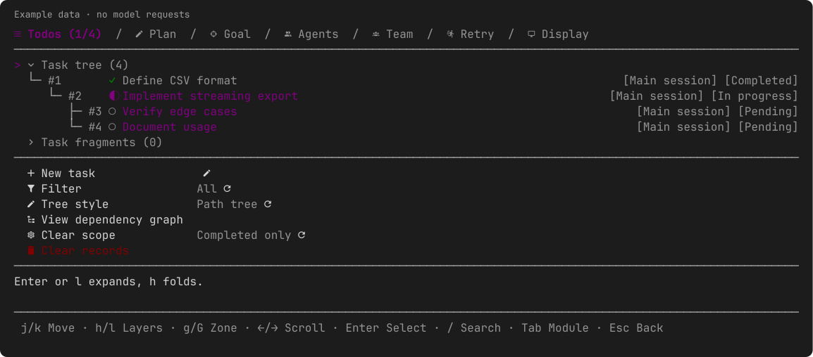
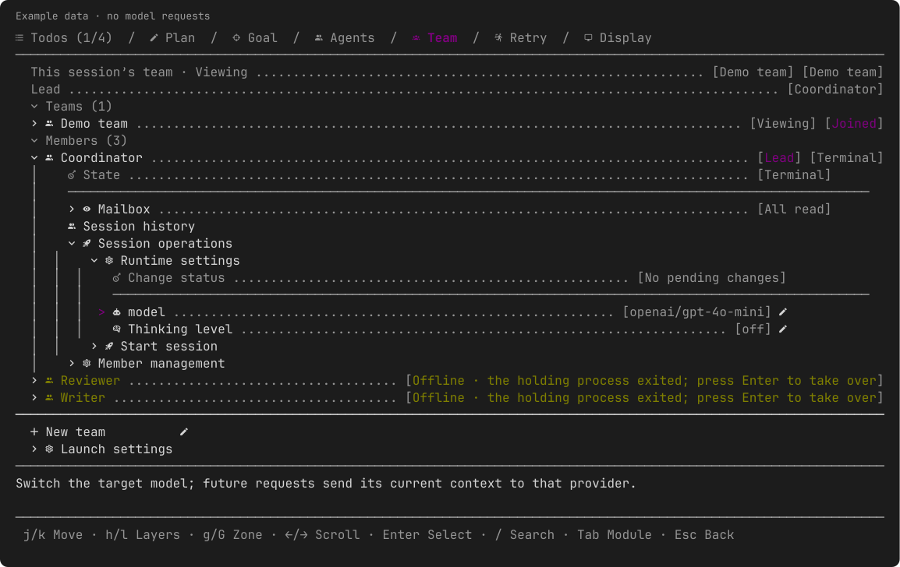

# pi-dag-workflow

[](https://github.com/Raix2215/pi-dag-workflow/actions/workflows/ci.yml)
[](https://pi.dev)
[](LICENSE)

English | [简体中文](README.zh-CN.md)

Session-local task DAG, read-only planning, subagents, autonomous goal continuation, resilient error recovery, and multi-session team collaboration for [Pi](https://pi.dev). Maintain one authoritative task list in your current session, monitor background agents in real time, and verify evidence before marking work complete.



*Example data rendered by the actual panels; no model requests were used to create the previews.*

## Highlights

- **Prerequisite tracking** — Enforce execution order with `blockedBy`. Tasks cannot start, complete, or dispatch until their prerequisites are fulfilled.
- **Read-only planning** — Read the code and structure the work before enabling implementation or child dispatch.
- **Parallel subagents** — Dispatch up to 8 independent Pi child processes with explicit tool allowlists, skill sets, bounded task briefs, and same-task resumption.
- **Goal continuation** — Continue long-running objectives across model turns with configurable pause policies, research modes, and pause-time progress notes.
- **Error retry** — Automatically retry model and network failures across configurable intervals and fallback models when enabled.
- **Team collaboration** — Coordinate independent Pi sessions in one workspace via point-to-point mailboxes, PID-verified liveness, and dynamic runtime model reconfiguration.

## Installation

Install the extension directly into Pi:

```bash
pi install https://github.com/Raix2215/pi-dag-workflow
```

Restart Pi or execute `/reload`. Enable or disable specific modules anytime using `pi config`.

Enable Todos, Plan, Agents, Goal, Retry and Team independently or in combination via `pi config`; Display is provided by any enabled module, not enabled separately.

### Compatibility & Requirements

- **Pi**: `1.3.0` or newer (Pi 1.0–1.2 are outside verified compatibility).
- **Node.js**: `>= 22.19.0` (required by package engines; subagents require a Node-based Pi host).
- **Terminal Font**: A [Nerd Font](https://www.nerdfonts.com/) is recommended for tab and status icons.
- **Localization**: Supports English and Simplified Chinese interfaces (`auto`, `en`, `zh-CN`).
- **Team launches**: Modes depend on installed terminals. Windows supports supported desktop terminals through direct argv; shell-based tmux, background, copy-command and custom-template launches are refused.

> **Note**: To prevent command and tool conflicts, avoid running multiple extensions providing identical names (e.g. standalone `todo`, `/plan`, `/goal`, `/retry`, or `subagent_spawn`).

## Quick Start

A typical workflow progresses from planning to execution and autonomous continuation:

1. **Plan safely without executing actions**:
   ```text
   /plan start
   ```
   Direct Pi to investigate the codebase and draft a Todo dependency graph:
   > "Inspect auth routes, plan token refresh with regression tests, and organize dependencies."

2. **Exit planning and review the task graph**:
   ```text
   /plan off
   /todos
   /dag
   ```
   `/todos` opens the interactive docked panel (`/todos paths` and `/todos flat` switch views); `/dag` opens the full scrollable dependency view.

3. **Drive continuous execution across turns**:
   ```text
   /goal new Implement token refresh and verify with tests
   /goal enable #1
   ```

---

## Core Modules

### 1. Tasks & Dependency DAG (`todo`)

The model interacts with the session DAG through the `todo` tool. Create tasks atomically in batches of 1–50 operations:

```json
{
  "action": "batch",
  "operations": [
    { "action": "create", "ref": "audit", "subject": "Audit authentication endpoints" },
    { "action": "create", "subject": "Implement refresh token", "blockedBy": ["@audit"] }
  ]
}
```

- **Atomic transactions**: `@ref` allows later creates within the batch to reference earlier ones. If any operation fails, the entire task list remains unchanged.
- **State lifecycle**: Tasks use `pending`, `in_progress`, `completed`, `failed`, `cancelled`, and `deleted`. Prerequisites must be completed before work begins. Completed tasks are terminal; create new work for rework.
- **Querying state**:
  - `{"action": "list", "ready": true, "limit": 50}`: List executable tasks whose prerequisites are satisfied (paged up to 200).
  - `{"action": "get", "id": 1}`: Inspect task details, direct blockers, and downstream dependants (`blocks`).
  - `{"action": "status"}`: Retrieve a compact read-only summary of mode, task counts, protection, and retry state.
- **Delivery vs. acceptance**: A child process completion or tool report delivery does not complete a task. The main session must independently verify files and tests before marking it `completed`.

### 2. Read-only Plan Mode (`/plan`)

Toggle plan mode with `/plan start` and `/plan off` (inspect settings and tools via `/plan settings` and `/plan tools`):
- Strictly blocks file writes, edits, and all shell execution tools (`bash`, `powershell`).
- Forbids subagent dispatch and starting or completing tasks.
- Allows reading files, searching repositories, asking structured user questions, and creating or adjusting task definitions.

### 3. Parallel Subagents (`agents`)

Dispatch independent background Pi child processes for isolated, verifiable assignments:
- **Strict single tier**: The main session dispatches child agents; child agents cannot spawn further subagents.
- **Configuration resolution**: Settings resolve through parent defaults -> named profiles -> call-level overrides (`model`, `thinking`, `tools`, `skills`).
- **Bounded briefs**: The `context: true` parameter supplies a concise brief (capped at 2,000 characters) containing prerequisite states and artifact references.
- **Skills**: Attach up to 8 local Markdown files (<= 64 KiB each); requires `read` in the child's active tool set (inherited or explicitly declared). Skills are local file references, not additional tools or permissions.
- **Steering & resumption**: Inspect running jobs with `subagent_inspect`, send messages or preflight tool updates via `subagent_send`, or resume prior attempts using `resumeFrom`.
- **Sandbox boundaries**: Profile `isolate` restricts extension loading for Team/manual session launches; child tool selection controls the selected tool set. Neither provides an OS or credential sandbox, and neither rolls back file changes.

For full protocol specifications, see [docs/COMMUNICATION.md](docs/COMMUNICATION.md).

### 4. Autonomous Goals (`goal`)

Manage multi-turn objectives with `/goal` and the `goal` tool:
- **Safe defaults**: Creating a Goal does not auto-start it. Resumed sessions keep Goals paused until explicitly activated with `/goal enable`.
- **Paused progress notes**: When paused, models can still record verified milestones (`progress`) or updated plans (`nextStep`) without resuming execution.
- **Stable contract context**: Keep the complete current objective visible without moving an unchanged fallback contract on every request. Continuation counts remain in Goal state and the UI, not in the model contract.
- **Stable pause recovery**: After compaction recovers a paused Goal's safety reminder, keep that reminder at a stable context position without resuming the Goal. Ordinary paused sessions do not add this recovery projection.
- **Control switches**:
  - `nopause`: Forbids interactive user questionnaires and mid-flight stops, but does *not* grant unlimited error retries.
  - `nolimit`: Removes the default 32-turn continuation limit without altering error retry counts.
  - `autoresearch`: Enforces continuous investigation loops without marking the Goal complete.

### 5. Error Recovery (`retry`)

Configure automated recovery from API failures, quota exhaustion, authentication errors, and network drops via `/retry`:
- **Default state**: Error retry is disabled by default (`off`).
- **User-defined intervals**: When enabled, the model retries using a sequence of specified pauses (e.g., `/retry when-error 5s,15s,30s count 3`). The `count` parameter is optional; omitting it allows recurring retries across the intervals without a fixed streak cutoff. Quota and authentication failures follow the same configured intervals.
- **One recovery owner**: With Retry enabled, Goal hands failures to it. Otherwise Goal uses its own bounded error backoff; its allowance is separate from Retry's count.
- **Fallback models**: Designate alternate models (`/retry models provider-b/backup-model`; replace this placeholder with a registered model). When the active model exhausts `after` consecutive plugin retry attempts (default 2; initial request failures and host-native retries do not count toward `after`), execution advances to the next candidate model while sharing the overall `count` budget. When the total `count` is exhausted, retries stop completely without switching further.
- **Compaction resilience**: When an error is followed by session compaction, continuation respects the `resumeAfterCompaction` setting and user pause controls rather than restarting unconditionally.
- **Safe restoration**: Reloading or resuming a session preserves retry parameters but resets state to `armed/off` without resurrecting defunct timers.

### 6. Multi-session Teams (`team`)

Open `/team` to create a team, then expand its row to join the current conversation or start a new member session. Starting a member does not move this conversation to that team.

Connect multiple independent Pi sessions in the same workspace:
- **Minimal model interface**: Models are restricted to two tools: `team_send` (point-to-point messaging) and `team_inspect` (`scope: "team"` reads the joined team, not the UI's viewed team, paged <= 20 members / 4 KiB; the default query reads self. Member snapshots <= 2 KiB, reply preview 240 characters, activity default 3 max 10).
- **User-role transport security**: Team messages travel over user-role channels. **Agent-authored messages do not constitute human authorization or grant expanded privileges.**
- **Membership snapshots**: Model context records membership and identity changes as stable session snapshots, not live roster refreshes. Use `team_inspect` for the current roster and activity.
- **PID liveness**: Member presence is verified via operating system process checks and real event records, avoiding spurious heartbeat timeouts. Disbanding archives team records without killing processes or deleting session files.
- **Live runtime reconfiguration**: From the Team panel, users can update a target member's model or reasoning level. Changes take effect before the target's next turn once its current reply and tool batch finish; submission is an update request, confirmed only when acknowledged by the target runtime. Switching providers directs subsequent turns to that provider. Existing running sessions require `/reload` to pick up newly added capabilities.
- **Initial launch names**: Set **Member name** and **Session name** separately in the new-session panel (`--team-member` and native `--name`). A member name alone leaves the session name at its host default; a session name alone also supplies the initial member name. Blank fields keep automatic `member-n` naming and the host's session-name default. Saved or renamed members retain their identity on resume and reload.
- **Bounded delivery recovery**: An unconfirmed delivery can be retried automatically once within a running member scope, only after a normal idle settlement with an explicitly empty host queue. If it remains unconfirmed, automatic delivery pauses with a notice; messages stay unread and can be retried from the panel. A successful real-input confirmation resumes the original delivery policy. Same-scope history navigation does not reset the exhausted budget.
- **Names and lifecycle**: Member labels and Pi session names are separate edits, addressed by full SID. Stop/removal preserves saved sessions and mailboxes; session-file/mailbox deletion is a separate confirmed action.
- **Clean startup**: Newly initialized blank team sessions respond with a brief startup confirmation before awaiting explicit assignments. Ordinary joins, re-attaching existing sessions, and `/reload` do not repeat this confirmation.
- **Read-only History**: Inspect session transcripts with Pi's native TreeSelector (press `Enter` to view entry content, `Esc` to return to the tree list, and `Esc` again to exit back to the Team panel).



---

## Docked Panels & Navigation

Running `/todos`, `/plan`, `/goal`, `/agents`, `/team`, `/retry`, or `/dag-display` opens a docked panel above the editor. Six extension modules are independently selectable in `pi config`; Display is shared UI, not a seventh extension. Disabled modules are omitted from the tab bar.

### Keyboard Shortcuts

| Key | Navigation / Action |
|---|---|
| `Tab` / `Shift+Tab` | Switch between active module tabs in place |
| `j` / `k` or `↓` / `↑` | Move row cursor down / up |
| `g` / `G` | Jump to the first row of the upper / lower zone |
| `←` / `→` | Scroll active zone by one screen |
| `h` / `l` | Collapse / expand details inline |
| `Enter` | Toggle switch, cycle option, edit text inline, or execute action |
| **Double `Enter`** | **In-place red prompt confirmation** for destructive actions (no popup page or window resizing) |
| `/` | Live filter / search within active view |
| `Esc` | Cancel inline edit, collapse view, or close the panel |

Panels automatically scale to terminal height without artificial row limits. User input and confirmation workflows are never interrupted by background periodic refreshes. Above-editor widgets hide while panels are open and restore upon dismissal.

Path rows use middle truncation to retain filename tails when space permits; stored paths and selection targets remain unchanged.

### Display Preferences (`/dag-display`)

Open `/dag-display` or select the **Display** tab to configure interface preferences:
- **Icon style**: Switch between Nerd Font icons and plain text symbols.
- **Language**: Choose `auto` (terminal locale), `en`, or `zh-CN`.
- **Status widgets**: Independently toggle persistent widgets for Todos, Plan, Goal, Agents, and Retry.
- **Model column width**: Configure display width limits for model labels.

---

## Commands & Tools Quick Reference

| Module | Slash Command | Registered Tools | Description |
|---|---|---|---|
| **Todos** | `/todos`, `/dag` | `todo` | Task DAG, dependency ordering, status updates, batch definition, `/todos paths`, `/todos flat` |
| **Plan** | `/plan` (`start`, `off`, `status`, `settings`, `tools`) | — | Read-only planning mode, shell/write block, and allowlist inspection |
| **Agents** | `/agents` | `subagent_spawn`, `subagent_inspect`, `subagent_send`, `subagent_cancel` | Single-tier child process dispatch, steering, and verification |
| **Goal** | `/goal` | `goal` | Multi-turn objective continuation, `nopause`, and `autoresearch` |
| **Retry** | `/retry` (`when-error`, `models`, `on`, `off`, `status`) | — | Error interval backoff, streak limits, and candidate model fallback chains |
| **Team** | `/team` | `team_send`, `team_inspect` | Multi-session workspace collaboration, mailboxes, and live controls |
| **Display** | `/dag-display` | — | Interface language, icons, model width, and widget visibility |

---

## Status & Permission Boundaries

- **English model prompts & localized UI**: Internal system prompts and instructions generated by the plugin are standardized in English. UI panels and menus support full localization in English and Simplified Chinese.
- **Session-bound state**: Tasks, Goals, and child records are tracked within the active Pi session branch. Session rollbacks do not resurrect exited child processes or revert file edits. Team rosters and mailboxes do not roll back with the Pi session branch.
- **Isolate boundary**: Profile `isolate` restricts extension loading for Team/manual launches; tool selection limits the selected tools. Neither provides an OS sandbox or rolls back file side effects.
- **Privacy boundary**: This extension adds no analytics or tracking requests. Model calls and other installed extensions still use their configured providers and network access.

## Documentation & Community

- [Agent Communication & Delivery Protocol](docs/COMMUNICATION.md)
- [Contributing Guidelines](CONTRIBUTING.md)
- [Security Policy](SECURITY.md)

## License

MIT © [Raix2215](https://github.com/Raix2215)
