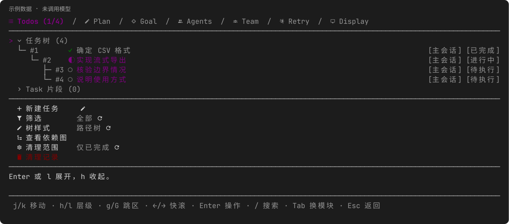
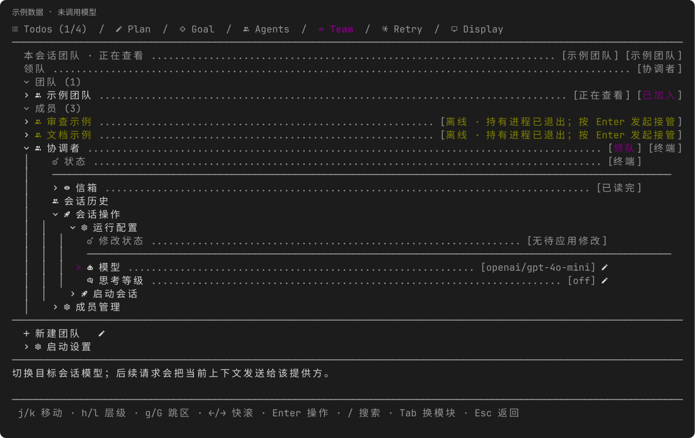

# pi-dag-workflow

[](https://github.com/Raix2215/pi-dag-workflow/actions/workflows/ci.yml)
[](https://pi.dev)
[](LICENSE)

[English](README.md) | 简体中文

为 [Pi](https://pi.dev) 提供会话级任务 DAG、只读规划、子代理、目标自动续跑、容错重试与多会话团队协作。在当前会话中维护唯一权威任务列表，实时追踪后台 Agent 动态，并在验收实证充分后将任务标记为完成。



*图中为真实面板渲染的示例数据；制作预览未调用模型。*

## 核心特性

- **前置依赖编排** — 通过 `blockedBy` 约束执行顺序。前置任务未全部验收完成前，后续任务不可启动、完成或派发。
- **只读规划模式** — 先阅读代码、检索符号并梳理任务，再切回执行模式进行实施与派发。
- **并行子代理** — 派发最多 8 个独立的 Pi 子进程处理解耦任务，支持工具白名单、Skill 挂载、有界上下文摘要与同任务接续。
- **目标跨轮续跑** — 通过 `/goal` 跨模型轮次推进长线任务，支持灵活暂停策略、持续研究模式及暂停态进度笔记。
- **错误自动重试** — 遇到接口错误、配额耗尽或网络异常时，在启用状态下按指定间隔自动重试，并支持备选模型轮换。
- **多会话团队协作** — 汇聚同一代码库下的独立 Pi 会话，提供点对点信箱、真实 PID 进程探活与会话级运行配置热切换。

## 安装指南

直接在 Pi 中安装本扩展包：

```bash
pi install https://github.com/Raix2215/pi-dag-workflow
```

安装后重启 Pi 或在会话中执行 `/reload`。随时可通过 `pi config` 独立启用或关闭各功能模块。

### 兼容性与运行环境

- **Pi 版本**：`1.3.0` 或更高（Pi 1.0–1.2 不在本次发布验证范围内）。
- **Node.js**：`>= 22.19.0`（包规范要求；子 Agent 功能需要 Node 运行时环境的 Pi 宿主）。
- **终端字体**：推荐使用 [Nerd Font](https://www.nerdfonts.com/) 终端字体以获得完整图标支持。
- **界面语言**：支持英文与简体中文界面（可在设置中指定 `auto`、`en` 或 `zh-CN`）。
- **Team 启动**：启动方式取决于已安装终端。Windows 仅支持受支持桌面终端的直接 argv 启动；基于 shell 的 tmux、后台、复制命令与自定义模板启动会被拒绝。

> **提示**：为避免命令与工具冲突，请勿同时装载提供同名入口的其他扩展（如独立的 `todo`、`/plan`、`/goal`、`/retry` 或 `subagent_spawn`）。

## 快速上手

典型工作流涵盖“只读规划 -> 结构化执行 -> 跨轮自治推进”：

1. **先只读规划**：
   ```text
   /plan start
   ```
   要求 Pi 分析仓库并梳理依赖图：
   > “分析鉴权接口改造需求，拆解为带回归测试的任务 DAG，明确依赖先后关系。”

2. **退出规划并检视任务图谱**：
   ```text
   /plan off
   /todos
   /dag
   ```
   `/todos` 打开交互式贴靠面板（可用 `/todos paths` 或 `/todos flat` 切换树/平铺视图）；`/dag` 打开可滚动依赖全景图。

3. **跨轮自主推进核心目标**：
   ```text
   /goal new 实现 Refresh Token 并通过端到端测试验收
   /goal enable #1
   ```

---

## 核心模块详解

### 1. 任务与依赖图 (`todo`)

模型通过 `todo` 工具管理会话任务图。支持在单次批量操作中原子提交 1–50 个定义变更：

```json
{
  "action": "batch",
  "operations": [
    { "action": "create", "ref": "audit", "subject": "审计鉴权接口端点" },
    { "action": "create", "subject": "实现 Refresh Token 鉴权逻辑", "blockedBy": ["@audit"] }
  ]
}
```

- **原子事务**：批处理支持通过 `@ref` 引用同批已经创建的任务。若其中任一步骤校验失败，整个列表状态完整回滚。
- **状态流转**：任务状态包括 `pending`、`in_progress`、`completed`、`failed`、`cancelled`、`deleted`。前置依赖完成后才可执行。已完成任务不能重开；返工需新建任务。
- **高频查询**：
  - `{"action": "list", "ready": true, "limit": 50}`：仅列出前置已完成、可立即执行的任务（单页最多 200 条，支持游标续页）。
  - `{"action": "get", "id": 1}`：查看任务完整定义、直接前置与下游受阻任务（`blocks`）。
  - `{"action": "status"}`: 获取紧凑只读摘要（规划模式、任务计数、保护项及重试状态）。
- **交付不等于验收**：子进程完成报告交付只代表执行结束；主会话必须在独立检查代码修改和测试证据后，才显式将任务标记为 `completed`。

### 2. 只读规划模式 (`/plan`)

通过 `/plan start` 开启、`/plan off` 退出（可通过 `/plan settings` 查看设置，`/plan tools` 查看只读工具）：
- 严格拦截文件写入、编辑以及一切 Shell 执行工具（`bash`、`powershell`）。
- 严禁子进程派发，禁止将任务标记为进行中或已完成。
- 允许文件阅读、代码符号检索、用户结构化提问以及创建或调整任务定义。

### 3. 并行子代理 (`agents`)

派发独立的后台 Pi 子进程执行高内聚、可独立验收的子任务：
- **严格单层结构**：主会话派发子 Agent；子 Agent 严禁进一步派发下层进程（无孙子代理）。
- **配置确定性解析**：参数按“父配置基线 -> 具名 Profile -> 显式单次调用参数（`model`、`thinking`、`tools`、`skills`）”依次覆盖。
- **有界上下文摘要**：开启 `context: true` 时提供前置状态和产物引用的有界摘要，上限 2,000 字符；不替代完整任务要求。
- **Skill 挂载**：支持引用最多 8 个本地 Markdown 文件（单文件 <= 64 KiB）；要求子进程可用工具集中包含 `read` 工具（继承或显式声明均可）。Skill 只作为本地文件引用，不增加工具或权限。
- **动态指导与接续**：通过 `subagent_inspect` 监视状态，`subagent_send` 发送指令或预检替换工具集，或使用 `resumeFrom` 在保留同任务绑定的前提下继续未完工作。
- **隔离与沙盒边界**：Profile `isolate` 限制 Team／手工会话启动时的扩展装载，子 Agent 的工具选择限制其所选工具；两者均不构成操作系统沙盒或凭据隔离层，亦无法自动回滚文件修改等外部副作用。

完整通信与报告交付协议参见 [docs/COMMUNICATION.md](docs/COMMUNICATION.md)。

### 4. 目标跨轮续跑 (`goal`)

通过 `/goal` 及模型工具 `goal` 驱动多轮长期目标：
- **安全启动**：创建 Goal 不会自动激活；会话重载或恢复后保持暂停，必须由用户通过 `/goal enable` 显式开启。
- **暂停态笔记**：在 Goal 暂停期间，模型仍可记录已验证的里程碑（`progress`）或调整下一步计划（`nextStep`），不影响暂停状态。
- **控制开关**：
  - `nopause`：运行中禁止向用户发起常规确认提问，但**不代表**无限错误重试。
  - `nolimit`：解除默认 32 轮续跑上限，不影响已设定的错误重试阈值。
  - `autoresearch`：开启持续自主探索模式，不自动将 Goal 标记为完成。

### 5. 错误自动重试 (`retry`)

通过 `/retry` 配置应对模型调用失败、配额耗尽、鉴权错误或网络中断：
- **默认关闭**：错误重试默认处于关闭状态（`off`）。
- **用户自定义间隔**：启用后按用户指定的等待时长序列循环重试（例如 `/retry when-error 5s,15s,30s count 3`）。`count` 为可选参数，省略时允许按该间隔列表持续重试，不设固定断点。配额与鉴权失败同样遵循该间隔配置。
- **恢复只由一方负责**：Retry 开启时，Goal 将失败移交给它；否则 Goal 使用自己的有界错误退避，两者次数独立记账。
- **备选模型轮换**：配置备选模型列表（`/retry models provider-b/backup-model`；将占位名称替换为实际注册模型）。当当前模型连续用尽 `after` 次插件重试尝试（默认 2 次；初始请求失败与宿主原生重试不计入 `after`）后，按顺序切换至下一个候选模型，所有重试共享总 `count` 次数额度。若总 `count` 额度耗尽，重试完全停止，不会换模型继续。
- **压缩续接控制**：当错误发生后紧接会话压缩时，恢复逻辑遵循 `resumeAfterCompaction` 设置与用户暂停控制，受控恢复而非无条件续接。
- **安全恢复机制**：会话分支恢复时保留配置但回到 `armed/off` 状态，不会在后台自动复活旧计时器。

### 6. 多会话团队协作 (`team`)

打开 `/team` 创建团队，再展开团队条目，选择加入当前对话或新建成员会话。新建成员不会改变本会话的归属。

将同一工作区下的多个独立 Pi 会话编组协作：
- **精简模型接口**：仅向模型暴露两个工具：`team_send`（点对点投递）与 `team_inspect`（`scope: "team"` 查询本会话所属团队，而非面板正在查看的团队，单页 <= 20 人 / 4 KiB；默认查自己。成员快照 <= 2 KiB，回复预览 240 字符，活动默认 3 条最多 10 条）。
- **消息安全准则**：团队消息通过 user-role 传输通道投递。**Agent 所发团队消息绝不代表人类授权，亦不能藉此扩展权限。**
- **基于真实 PID 探活**：成员存活按系统 PID 探测，活动来自真实事件，不按心跳超时判断进程死亡。解散团队仅作状态归档，不终止进程，不删除会话文件。
- **运行配置热调整**：用户可在 Team 面板直接调整目标成员的模型或思考级别；目标成员忙时需等待当前回复与工具批次结束，下一轮请求前生效；提交仅为请求，以目标运行时实际回执为准；切换提供商后后续请求自动发送至该提供商。已有运行中的会话进程需手动执行 `/reload` 方能加载新能力。
- **名称与生命周期**：成员名与 Pi 会话名独立修改，按完整 SID 寻址。停止／移出保留会话与信箱；删除会话及信箱是单独的确认操作。
- **纯净空白启动**：新建空白会话仅执行首轮收到确认，不调用工具或执行任务；普通加入、恢复已有会话及 `/reload` 均不重复执行该确认。
- **只读历史查看**：通过 Pi 原生 TreeSelector 只读翻阅会话历史记录（按 `Enter` 查看选中条目正文，按 `Esc` 返回树列表，再次按 `Esc` 退出历史并返回 Team 面板）。



---

## 交互式面板与键盘操控

执行 `/todos`、`/plan`、`/goal`、`/agents`、`/team`、`/retry` 或 `/dag-display` 即可在输入框上方展开贴靠面板。六个扩展模块可通过 `pi config` 独立选择；Display 是共享界面，不是第七个扩展，标签栏省略未启用的模块。

### 键盘快捷键一览

| 按键 | 导航与操作说明 |
|---|---|
| `Tab` / `Shift+Tab` | 在已启用的模块标签页之间就地切换 |
| `j` / `k` 或 `↓` / `↑` | 上下移动当前光标所在行 |
| `g` / `G` | 快速跳转至上区 / 下区首行 |
| `←` / `→` | 当前区域按整屏向上 / 向下翻页 |
| `h` / `l` | 就地折叠 / 展开选中条目的详细信息 |
| `Enter` | 切换开关、轮转选项、行内编辑文本或触发动作 |
| **双击 `Enter`** | **原位红字确认**破坏性操作（无独立弹出页，无需放大窗口） |
| `/` | 激活实时过滤与关键词检索 |
| `Esc` | 取消正在进行的编辑、折叠层级或关闭停靠面板 |

面板高度自动适配终端尺寸，无 17 行硬性上限；用户的输入与确认流程不会被后台周期刷新打断。面板展开期间，输入框上方的状态挂件自动暂时隐藏，关闭后无损恢复。

### 界面与显示设置 (`/dag-display`)

通过 `/dag-display` 或面板中的 **Display** 标签定制界面风格：
- **图标风格**：支持在 Nerd Font 图标与纯文本 ASCII 符号间切换。
- **界面语言**：可选择 `auto`（随系统区域环境）、`en` 或 `zh-CN`。
- **状态挂件**：独立控制 Todos、Plan、Goal、Agents、Retry 在输入框上方的常驻状态条显隐。
- **模型名显示宽度**：自定义状态行与列表中模型名称的最大截断列宽。

---

## 命令与模型工具速查

| 模块 | 斜杠命令 | 注册的模型工具 | 简要说明 |
|---|---|---|---|
| **Todos** | `/todos`, `/dag` | `todo` | 任务 DAG 依赖编排、状态管理、批量事务、`/todos paths` 树视图、`/todos flat` 平铺视图 |
| **Plan** | `/plan` (`start`, `off`, `status`, `settings`, `tools`) | — | 只读规划模式切换、Shell/写入拦截与只读白名单查看 |
| **Agents** | `/agents` | `subagent_spawn`, `subagent_inspect`, `subagent_send`, `subagent_cancel` | 单层子进程派发、状态探查、动态指令与验收管理 |
| **Goal** | `/goal` | `goal` | 多轮目标自主续跑、`nopause` 模式、`autoresearch` 持续探索 |
| **Retry** | `/retry` (`when-error`, `models`, `on`, `off`, `status`) | — | 错误阶梯退避、重试阈值与候选模型故障轮换 |
| **Team** | `/team` | `team_send`, `team_inspect` | 同仓库多独立会话协作、信箱流转与运行配置热改 |
| **Display** | `/dag-display` | — | 显示语言、图标风格、模型名宽度与常驻挂件显隐 |

---

## 状态与权限边界

- **系统模型指令英文统一与多语言 UI**：插件自编的系统提示与模型指令统一采用 **英文**。面板与交互菜单提供完整的英文与简体中文本地化支持。
- **分支权威与持久化**：任务、目标及子进程记录紧密绑定当前 Pi 会话分支。分支回滚不会自动复活已退出的外部进程，亦不回滚工作区文件修改。Team 名册和信箱不随会话分支回滚。
- **Profile 隔离边界**：Profile `isolate` 限制 Team／手工会话启动的扩展装载，工具选择限制所选工具；两者均不构成操作系统级进程沙盒，无法自动撤销工具执行带来的外部副作用。
- **隐私边界**：本扩展不添加分析统计或追踪请求；模型调用和你安装的其他扩展仍遵循各自的提供方与网络配置。

## 公开参考链接

- [Agent 通信与报告交付规范](docs/COMMUNICATION.md)
- [贡献指南 (CONTRIBUTING)](CONTRIBUTING.md)
- [安全策略 (SECURITY)](SECURITY.md)

## 开源协议

MIT © [Raix2215](https://github.com/Raix2215)
